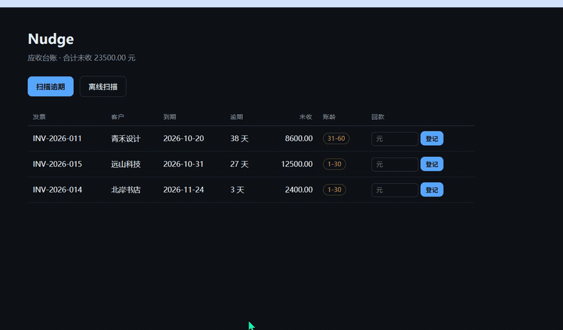

# Nudge · Receivables and dunning

[](https://github.com/wushiyi105-jpg/nudge/actions)




Work is done — has the money arrived, who to chase, and how to say it.

## Features

- **Aging ledger**: buckets at 1-30 / 31-60 / 61-90 / 90+, outstanding balance at a glance.
- **Client payment profile**: average delay history decides the dunning stage.
- **Three tones**: gentle, firm, final notice — chosen by overdue days and history, not by mood.
- **Number guard**: any amount or day count missing from the ledger is dropped from the model's message.
- **Job queue**: failed pushes retry with backoff, no duplicate message per stage per day.
- **Webhook delivery**: Feishu / DingTalk / WeCom bots.
- **CLI + Web**: terminal table or browser.

## Quick start

```bash
pip install -e .
python -m nudge seed
python -m nudge scan
python -m nudge serve        # http://127.0.0.1:8000
```

## Why not just ask a general LLM

It does not know how often this client paid late, which dunning stage applies, or whether the amount in its own text matches the ledger. Nudge computes all three locally and only lets the model phrase the message.

**Was the Docker image verified?**
Docker is not installed on the build machine, so docker build . was not run and the image is unverified; only the Dockerfile and ports were checked statically.

## Author

Shiyi · GitHub [@wushiyi105-jpg](https://github.com/wushiyi105-jpg) · 18384198104
