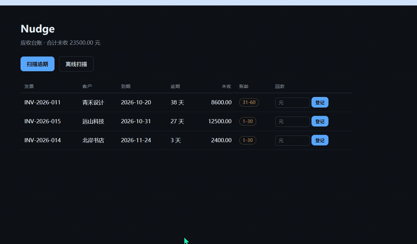
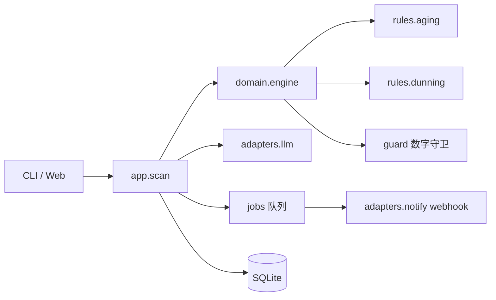

# Nudge · 应收与催款台账

[](https://github.com/wushiyi105-jpg/nudge/actions)




干完的活，钱到没到、该催谁、怎么开口。

把客户、发票、回款录进去，Nudge 算账龄、看这个客户以前拖多久、决定这一轮用几档语气，
再把话写出来发到你常用的群里。数字全在本地算，模型只负责说话。

## 功能特性

- **账龄台账**：按 1-30 / 31-60 / 61-90 / 90+ 分桶，未收金额一眼看清
- **客户付款画像**：历史平均拖延天数，决定催收档位（老拖的客户自动升一档）
- **三档语气**：温和、明确、最后通牒，按逾期天数和历史自动选
- **数字守卫**：模型写出的消息里出现台账之外的金额/天数，整句丢弃，宁可少说
- **任务队列**：推送失败进队列按 5/10 分钟退避重试，同一天同一档不重复发
- **群消息推送**：飞书/钉钉/企微机器人 webhook 通用
- **CLI + Web 双入口**：`nudge scan` 看终端表格，`nudge serve` 开网页

## 快速开始

```bash
pip install -e .
python -m nudge seed          # 写入示例数据
python -m nudge scan          # 扫描逾期（没有 API key 走离线模式）
python -m nudge serve         # 打开 http://127.0.0.1:8000
```

配置模型（可选，不配也能跑）：

```bash
cp .env.example .env
# 填 NUDGE_LLM_API_KEY 即启用模型；留空则用内置文案模板
```

## 为什么不用通用大模型直接问

直接把发票信息丢给 ChatGPT，它也能写一段催款话。问题是它不知道：

1. **这个客户以前拖过几次**——同一个客户被拖成习惯，还用第一次的语气，等于没催
2. **这次该用第几档**——温和、明确、最后通牒，靠逾期天数和历史算出，不靠感觉
3. **消息里的数字对不对**——模型很容易把 1250 写成 1200，或者自己编一个"违约金 500 元"

第一、二条是规则问题，本地算得比模型准；第三条是安全问题，所以 Nudge 里有一条**数字守卫**：
消息按句检查，只要出现台账里没有的数字，整句丢掉。你看到的消息，每个数字都能在台账里找到出处。

模型在这里只做一件事：**把已经算好的事实说成人话**。

## 适用场景

- 自由职业者：设计、开发、写作、摄影，手上 3–10 个客户
- 小工作室：2–5 人，共用一本账
- 任何"干完活等回款、催又不好意思"的人

不适合：有专职财务的公司（用 ERP）、纯一次性交易（不需要台账）。

## Roadmap

- [x] 账龄分桶与客户画像
- [x] 三档催收与数字守卫
- [x] 任务队列与幂等去重
- [x] CLI + Web
- [ ] 从聊天记录抽"下周三给"的承诺并跟踪
- [ ] 分期回款计划（按里程碑拆）
- [ ] 多币种与汇率
- [ ] 导出对账单 PDF

## FAQ

**没有 API key 能用吗？**
能。离线模式用内置的三档文案模板，数字来自台账，结构与模型输出一致。

**消息发出去会重复吗？**
不会。幂等键是「发票 + 档位 + 日期」，同一天同一档只排一次。

**模型要是乱写怎么办？**
数字守卫会按句丢弃。全被丢弃时降级为离线模板。

**数据在哪？**
本地 SQLite（`data/nudge.db`），不上传任何地方。

**Docker 镜像验证了吗？**
CI 的 `docker` job 每次执行 `docker build .`，启动容器并轮询 `/health`；本机没有 Docker，本地未重复跑。

## 命令参考

```bash
python -m nudge seed                     # 示例数据
python -m nudge scan [--json] [--offline] # 扫描逾期
python -m nudge jobs [--dry-run]          # 发送队列
python -m nudge pay <发票ID> --amount 500 # 登记回款
python -m nudge report                    # 账龄汇总
python -m nudge serve --port 8000         # Web
python -m nudge doctor                    # 环境自检
```

退出码：`0` 成功 / `1` 运行错误 / `2` 参数错误。

## 依赖说明

| 依赖 | 解决什么 |
|---|---|
| `fastapi` + `uvicorn` | Web 入口与路由 |
| `pydantic` + `pydantic-settings` | 配置解析与结构化校验 |
| `httpx` | 模型调用与 webhook，带超时 |
| `jinja2` | 服务端渲染页面 |
| `typer` + `rich` | CLI 与终端表格 |
| `sqlalchemy` | 台账与任务队列的持久化 |

## 工作原理



一次扫描：读未结发票 → 算逾期与档位 → 写消息（模型或离线模板）→ 过数字守卫 → 入队 → 推送。

## 目录结构

```
nudge/
├── nudge/
│   ├── domain/      models.py  engine.py  guard.py  rules/
│   ├── ports/       Protocol 定义
│   ├── adapters/    llm/  store/  notify/
│   ├── app/         scan.py  jobs.py
│   ├── iface/       cli.py  web.py
│   └── config.py  doctor.py  __main__.py
├── prompts/         版本化提示词
├── templates/       Jinja2 页面
├── data/            种子数据
└── tests/           规则、引擎、守卫、队列
```

## 作者

shiyi · GitHub [@wushiyi105-jpg](https://github.com/wushiyi105-jpg) · 18384198104
